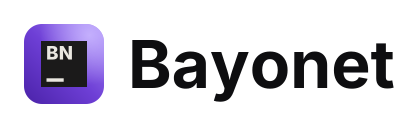
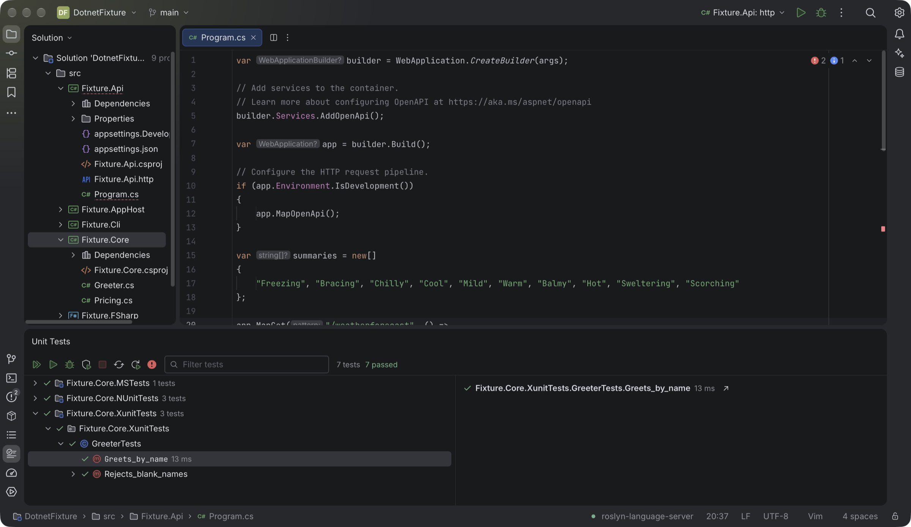

<p align="center">
  <picture>
    <source media="(prefers-color-scheme: dark)" srcset="src-tauri/icons/source/bayonet-wordmark-dark.svg">
    
  </picture>
</p>

<p align="center">
  <b>A fast, open-source .NET IDE with a Rust core.</b><br>
  C#, F#, solutions, NuGet, tests and debugging, in a native app that opens in under a second.
</p>

<p align="center">
  <a href="https://skuirrels.github.io/bayonet-releases/"></a>
  <a href="LICENSE"></a>
  
  
  
  
</p>

<p align="center">
  <a href="#why-bayonet">Why Bayonet</a>
  &nbsp;·&nbsp;
  <a href="#features">Features</a>
  &nbsp;·&nbsp;
  <a href="#getting-started">Getting started</a>
  &nbsp;·&nbsp;
  <a href="#plugins">Plugins</a>
  &nbsp;·&nbsp;
  <a href="docs/rider-clone-spec.md">Roadmap</a>
</p>

<p align="center">
  
</p>

Bayonet is a desktop IDE for .NET developers who want a full-featured environment
without the weight. The editor, indexing and tool windows run in a Rust core; C# and
F# intelligence come from Roslyn and FsAutoComplete, the same open-source engines the
rest of the ecosystem uses. It is built on [OpenIDEA](https://github.com/l0ng-ai/openidea)
and refocused on .NET.

## Why Bayonet

**Light enough to leave open.** Opening a 100-project C# solution, warm, on an
M-series Mac (14 cores, 24 GB), medians:

|                            | Bayonet           | Rider 2026.2.4 |
| -------------------------- | ----------------- | -------------- |
| Window with the solution   | **0.8 s**         | 8.1 s          |
| All 100 projects evaluated | 8.9 s             | 8.5 s          |
| Memory after idle          | **791 MB**        | 3712 MB        |
| Idle CPU                   | **1 %** of a core | 11 %           |
| Caches on disk             | **8 MB**          | 2173 MB        |

Memory is the summed footprint of every process, language servers and MSBuild nodes
included. Rider analyses more deeply, so "evaluated" is not the same work on both sides.
Method, caveats and how to run it yourself: [`docs/porting.md`](docs/porting.md#typing-latency-nfr-3)
and [`perf/compare`](perf/compare).

**Responsive while you type.** Typing stays within one 60 Hz frame (p95 16.7 ms), and
the completion popup paints in under 70 ms (p95).

**Yours.** No telemetry: every SDK command the IDE runs opts out of .NET's. No account,
no licence server. Apache 2.0, built only on components you can redistribute.

**Familiar.** The Visual Studio keymap is the default, with IntelliJ presets one click
away. Search Everywhere, tool windows and the Solution Explorer work the way you expect.

## Features

**Code**

- Roslyn-powered completion, diagnostics, quick fixes, inlay hints and solution-wide analysis
- Refactorings: rename, extract method, introduce variable, extract interface, inline, move type to file and more
- Go to declaration into packages and the BCL, through Source Link or decompiled sources
- Call and type hierarchies, find usages, structural search and replace
- Source generators listed in the Solution Explorer, with their generated files
- F# via FsAutoComplete, Razor and Blazor via Roslyn, XAML binding completion for WPF, Avalonia, MAUI and WinUI

**Solutions and builds**

- Solution Explorer for `.slnx`, `.sln` and `.slnf`; add, remove and reference projects
- Build progress per project, and a built-in MSBuild binary log viewer with a timeline
- Hot Reload through `dotnet watch`, Publish to folders, profiles or container images
- Project dependency diagram

**Run, debug and test**

- Debugging with netcoredbg: breakpoints, attach to process (including inside Docker containers), Parallel Stacks, collections as tables
- Unit Tests window for xUnit, NUnit and MSTest, with data-driven rows, debugging and continuous testing
- Code coverage in the gutter and the project tree

**Packages, data and frameworks**

- NuGet tool window: browse, install, update and audit packages
- .NET Aspire dashboard for AppHost solutions
- Entity Framework Core migrations and scaffolding, user secrets editor
- Visual Studio-compatible `.http` files, plus a database client
- Avalonia XAML previewer

**Diagnostics**

- Live counters, thread stacks, GC heap snapshots and dumps for running .NET apps
- CPU traces as flame graphs, mapped back to your code with timings shown in the editor

**And the rest of a full IDE**

Git, terminal, database tools, an HTTP client, remote development over SSH, AI agents,
and editing for 70+ languages, inherited from OpenIDEA.

## Getting started

Download the installers from the [Bayonet download page](https://skuirrels.github.io/bayonet-releases/)
(the same files are on the [latest release](https://github.com/skuirrels/bayonet-releases/releases/latest) of `skuirrels/bayonet-releases`).
Installed copies update themselves.

To build from source instead, you need Rust 1.96 or later,
Node 22.18 or later, pnpm, the [Tauri prerequisites](https://v2.tauri.app/start/prerequisites/)
and the [.NET 10 SDK](https://dotnet.microsoft.com/download).

```sh
git clone https://github.com/skuirrels/bayonet.git
cd bayonet
pnpm install
pnpm tauri dev
```

Open a folder containing a solution. Bayonet installs Roslyn, netcoredbg and the other
.NET tools it needs on first use; none are bundled. [`fixtures/dotnet`](fixtures/dotnet)
is a small solution that exercises most features.

<details>
<summary>Optional: notebook kernel tests</summary>

Native notebook execution tests are opt-in and need two distinct Python environments
with `ipykernel` installed:

```sh
OPENIDEA_TEST_PYTHON=/first/env/bin/python \
OPENIDEA_TEST_PYTHON_SECOND=/second/env/bin/python \
cargo test -p ide-notebook --test kernel_runtime -- --ignored --test-threads=1
```

</details>

## Status

Early, and moving fast. Daily C# work (edit, build, run, debug, test, NuGet) is in
place; see the [specification](docs/rider-clone-spec.md) for the plan and what is left,
and the [porting notes](docs/porting.md) for how each feature was built and checked.
Unity and Mono debugging are out of scope for now.

## Plugins

Plugins add actions, completion, quick fixes, tool windows, custom editors,
themes, file icons and languages. They run as sandboxed WebAssembly components;
themes, icon themes and languages need no code at all.

Install them from Settings › Plugins, or start your own with
`openidea-plugin new`. See [Writing OpenIDEA plugins](plugins/README.md) and
the [official plugins](plugins/official). The plugin API is still a preview.

## Contributing

Issues and pull requests are welcome. [`CONTRIBUTING.md`](CONTRIBUTING.md) covers the
workflow and [`CLAUDE.md`](CLAUDE.md) the layout and rules of the codebase.

## Licence

[Apache 2.0](LICENSE). See [`NOTICE`](NOTICE) for attribution, including OpenIDEA, and
[`THIRD_PARTY_LICENSES.md`](THIRD_PARTY_LICENSES.md) for bundled third-party assets.
Database tool window notes, including Oracle Instant Client setup, are in
[`docs/databases.md`](docs/databases.md).

<sub>Not affiliated with JetBrains or Microsoft. IntelliJ IDEA and Rider are trademarks of JetBrains s.r.o. .NET is a trademark of Microsoft Corporation.</sub>
